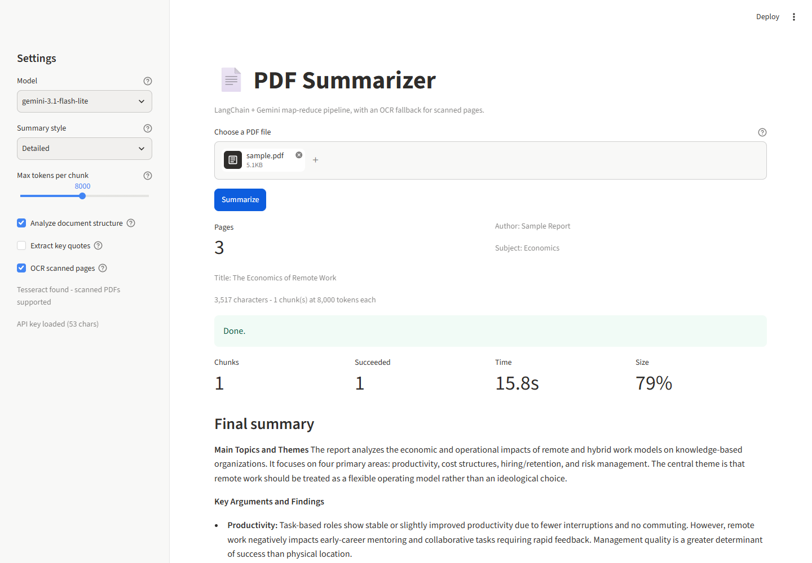

# PDF Summarizer (LangChain + Gemini)

An end-to-end PDF summarizer: extract text (with an OCR fallback for scanned pages), split it
into token-budgeted chunks, summarize each chunk with Google Gemini through LangChain, then merge
the results into one final summary. Ships as a **Streamlit app** and a **headless CLI**.



## Features

- **Map-reduce summarization** — every chunk is summarized independently, then a reduce step
  merges them without repetition.
- **Four styles** — `brief`, `detailed`, `bullet_points`, `executive`.
- **OCR fallback** — pages with no text layer are rendered with PyMuPDF and read by Tesseract, so
  scanned PDFs work too. Mixed documents are handled page by page.
- **Token-aware chunking** — chunks are measured with tiktoken, so they never exceed the budget.
- **Failure isolation** — one bad chunk does not lose the document; failures are listed and the
  rest is summarized. Transient 429/5xx responses are retried with exponential backoff.
- **Optional extras** — document-structure analysis and key-quote extraction.
- **Exports** — a plain-text report and per-chunk statistics as CSV.
- **Headless CLI** — same pipeline, no browser: `python -m pdfsummarizer.cli report.pdf`.

## How it works

```
PDF ──► extract text ──► clean ──► chunk by tokens
             │ (pages with no text layer are OCR'd)
             ▼
      ┌──────┴───────┬──────────────┐
      ▼              ▼              ▼
  summary 1      summary 2  …  summary N     (map, 2 at a time)
      └──────┬───────┴──────────────┘
             ▼
       combine ──► final summary             (reduce)
```

## Quickstart

Requires **Python 3.10+**.

```powershell
# Windows PowerShell
python -m venv .venv
.\.venv\Scripts\Activate.ps1
pip install -e ".[dev]"
Copy-Item .env.example .env      # then add your key
streamlit run app.py
```

```bash
# macOS / Linux
python -m venv .venv
source .venv/bin/activate
pip install -e ".[dev]"
cp .env.example .env             # then add your key
streamlit run app.py
```

Get a free key at [aistudio.google.com/apikey](https://aistudio.google.com/apikey) and put it in
`.env`:

```dotenv
GEMINI_API_KEY=your_key_here
GEMINI_MODEL=gemini-3.1-flash-lite
```

The editable install is required: the code lives in `src/pdfsummarizer/`, so `app.py` can only
import it after `pip install -e .`. The `-e .` entry in `requirements.txt` also installs the
package on deployment platforms that install dependencies from that file.

Try it without your own document — the repo includes a three-page sample:

```bash
python -m pdfsummarizer.cli samples/sample.pdf --style brief
```

## OCR setup (scanned PDFs)

OCR needs the **Tesseract** binary; the Python side (`pymupdf`, `pytesseract`, `pillow`) is already
in `requirements.txt`.

```powershell
winget install --id UB-Mannheim.TesseractOCR
& "C:\Program Files\Tesseract-OCR\tesseract.exe" --version
```

```bash
# macOS
brew install tesseract
# Debian / Ubuntu
sudo apt install tesseract-ocr
```

The app looks for `tesseract` on `PATH` and in the standard Windows install locations. If yours
lives somewhere else, set `TESSERACT_CMD` in `.env`. The sidebar shows whether Tesseract was found;
if it is missing, text pages still summarize and scanned pages are reported as skipped.

OCR only runs on pages with **less than 30 characters** of extractable text, so normal PDFs pay
nothing for it. Very large scans are capped by `OCR_MAX_PAGES`.

## CLI

```bash
python -m pdfsummarizer.cli report.pdf                       # detailed summary
python -m pdfsummarizer.cli report.pdf --style bullet_points --analysis --quotes
python -m pdfsummarizer.cli scan.pdf --ocr --ocr-max-pages 10
python -m pdfsummarizer.cli report.pdf --out summary.txt --csv chunks.csv
python -m pdfsummarizer.cli --check-config                   # settings, key masked
```

Exit codes: `0` success, `1` pipeline/API failure, `2` usage or configuration error. Progress goes
to stderr and the report to stdout, so you can pipe it.

## Configuration

| Variable | Default | Purpose |
| --- | --- | --- |
| `GEMINI_API_KEY` | — | **Required.** Google AI Studio key. |
| `GEMINI_MODEL` | `gemini-3.1-flash-lite` | Any model your key can access. |
| `TEMPERATURE` | `0.3` | Lower is more literal. |
| `MAX_TOKENS_PER_CHUNK` | `8000` | Chunk budget; smaller means more requests. |
| `MAX_CONCURRENCY` | `2` | Parallel chunk requests; raise on paid tiers. |
| `OCR_ENABLED` | `true` | OCR pages with no text layer. |
| `OCR_DPI` | `200` | Render resolution; higher is slower and more accurate. |
| `OCR_MAX_PAGES` | `30` | Cap on OCR'd pages per document. |
| `OCR_LANG` | `eng` | Tesseract language pack. |
| `TESSERACT_CMD` | auto | Explicit path to `tesseract.exe`. |

Environment variables win over `.env`, which is convenient for CI.

## Project structure

```
app.py                        Streamlit entry point
src/pdfsummarizer/
  config.py                   validated settings from the environment
  pdf.py                      extraction, cleaning, token counting, chunking
  ocr.py                      PyMuPDF + Tesseract fallback
  prompts.py                  system persona, styles, four prompt templates
  chains.py                   LangChain runnables (retry, text parsing)
  summarize.py                map-reduce orchestration and result dataclasses
  export.py                   text report and CSV statistics
  cli.py                      headless entry point
  ui/app.py, ui/components.py Streamlit UI
tests/                        46 offline tests + opt-in live/OCR tests
samples/sample.pdf            generated by scripts/make_sample_pdf.py
```

## Testing

```bash
pytest                 # offline: fake models, generated PDFs, Streamlit AppTest
pytest -m ocr          # OCR tests (skipped automatically if Tesseract is missing)
pytest -m live         # one real Gemini call (needs GEMINI_API_KEY)
ruff check .
```

The default run makes **no network calls**: chains are exercised with
`FakeListChatModel`, PDFs are generated with PyMuPDF, and the UI is booted through
`streamlit.testing.v1.AppTest`.

## Troubleshooting

| Symptom | Fix |
| --- | --- |
| `429 RESOURCE_EXHAUSTED` | Free tier limit. Lower `MAX_CONCURRENCY` to `1`, wait a minute, or use smaller chunks. |
| `404 model not found` | Set `GEMINI_MODEL` to a model your key can access. |
| `No extractable text` | The PDF is scans. Enable OCR and install Tesseract. |
| `Tesseract not found` | Install it (above) or set `TESSERACT_CMD`. |
| `ModuleNotFoundError: pdfsummarizer` | Run `pip install -e .` from the repo root. |
| OCR takes minutes | Lower `OCR_MAX_PAGES` or `OCR_DPI`. |
| Password-protected PDF | Not supported; remove the password first. |

Windows consoles can mangle emoji, so the CLI prints ASCII only; the Streamlit UI uses emoji.

## Cost and latency

A run costs `chunks + 1` model calls (plus one each for analysis and quotes). With the default
`gemini-3.1-flash-lite` and 8k-token chunks, a 30-page report is usually 3–5 calls and finishes in
under a minute. Chunk count is shown before the run, and more than 40 chunks triggers a warning.

## License

MIT — see [LICENSE](LICENSE).
